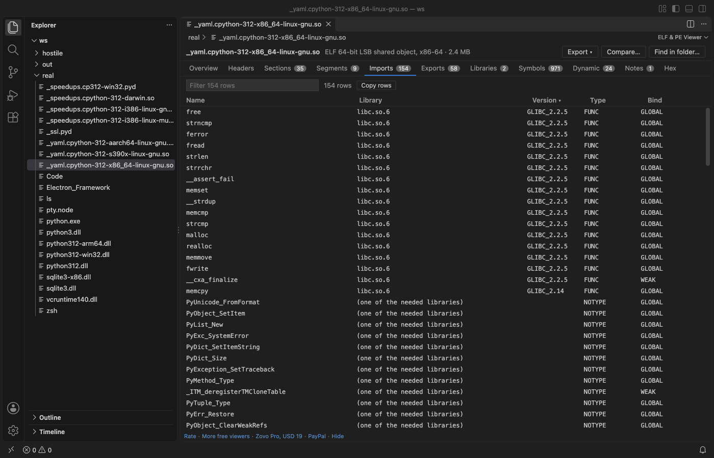
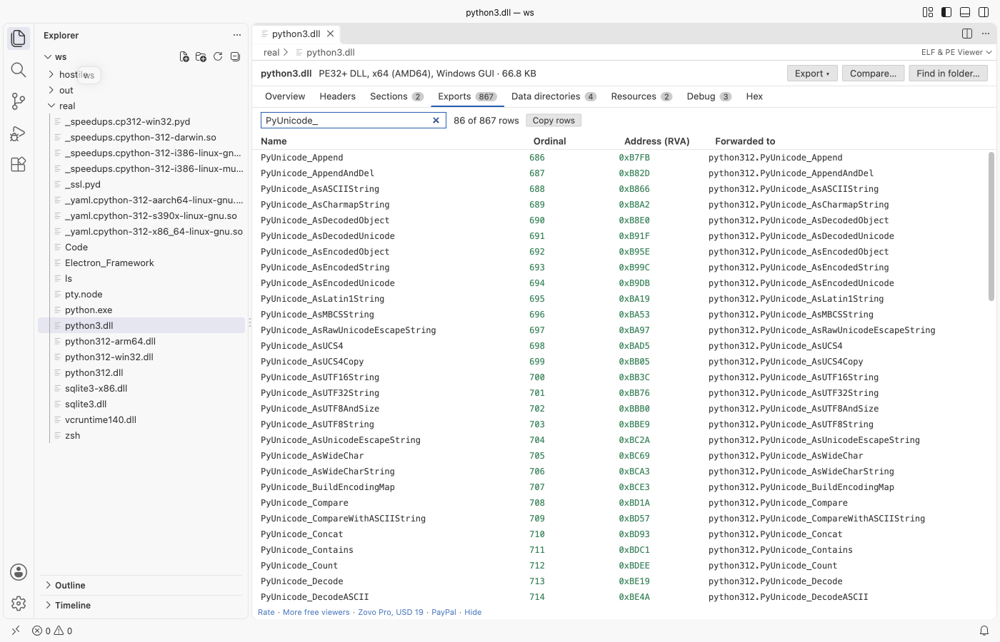
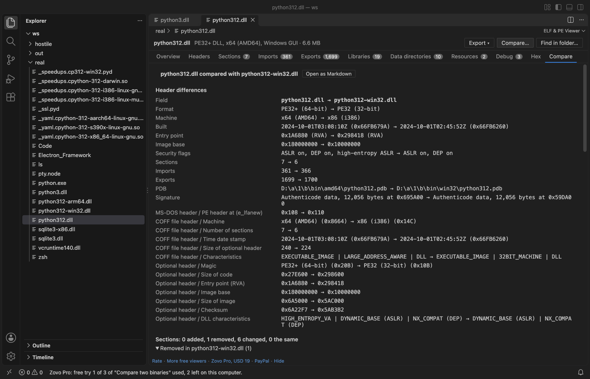

# ELF Viewer & PE Viewer for VS Code (DLL, EXE, Mach-O)

Open a `.so`, `.o`, `.exe`, `.dll`, `.sys` or `.dylib` file in VS Code and read its structure: headers, sections, segments, imports, exports, symbols and the raw bytes. One viewer for Linux and Unix ELF, Windows PE and Apple Mach-O files, universal binaries included. Read-only, no network, fast on 500 MB files.

## What you see

| Format | Files | Tabs |
|---|---|---|
| ELF (32 and 64-bit, little and big endian) | `.so`, `.so.1`, `.o`, `.ko`, `.elf`, `.axf`, Linux executables | Header, sections, segments (program headers), imports with library and version, exports, symbols (.symtab and .dynsym), dynamic section, notes (build ID) |
| PE (PE32 and PE32+) | `.exe`, `.dll`, `.sys`, `.efi`, `.ocx`, `.pyd`, `.cpl`, `.scr` | DOS, COFF and optional headers, data directories, sections, imports by name and ordinal, delay-load imports, exports with forwarders, resources, debug info (PDB path), .NET runtime |
| Mach-O (32 and 64-bit, universal) | `.dylib`, `.bundle`, macOS and iOS executables | Header, load commands, segments and sections, linked libraries, imports with the library of each symbol, exports (export trie), symbols, UUID, platform and SDK |

- Overview first: architecture, type, entry point, linked libraries, security flags (ASLR, DEP, Control Flow Guard), signature, build ID, PDB path.
- Every table can be filtered, sorted by any column and copied as tab-separated text. Tables with 100,000 rows scroll smoothly.
- Bytes behind every row: the `bytes` link on a section, segment or load command, and the offset next to each header field, open the Hex tab with those bytes marked.
- Field tree: every header field with its offset, size and value, from the same binary templates as [Hex Viewer](https://marketplace.visualstudio.com/items?itemName=zovo.zovo-hex-viewer).
- Universal binaries: pick the architecture (for example arm64 or x86_64) at the top; each slice is read on its own.

## Open a file

- Click a `.exe`, `.dll`, `.so` or `.dylib` file in the Explorer. It opens in the viewer.
- Files without an extension (Linux and macOS executables): right-click, Open in ELF & PE Viewer. Or use Open With... and pick ELF & PE Viewer (any file).
- Command Palette: ELF & PE Viewer: Open in ELF & PE Viewer.

## Free and Pro

Everything above is free, with no limit and no sign-in. Three Zovo Pro tools save time on bigger jobs. Each has 3 free tries on your computer, and a try counts only when the tool gives you a result.

| Tool | Free | Zovo Pro |
|---|---|---|
| Headers, sections, segments, imports, exports, symbols, hex view, field tree, filter and copy | yes | yes |
| Export the structure as JSON or as a C header (one struct and one const array per table) | 3 tries | yes |
| Compare two binaries: changed header fields, added and removed sections, libraries, imports and exports | 3 tries | yes |
| Find a symbol, import or library name in every binary of a folder (plain text or /regex/) | 3 tries | yes |

Zovo Pro is USD 19 once and turns on the Pro tools in every Zovo extension. Nothing about Pro shows when you open a file; it only comes up when you click one of the three tools. To hide the buttons, set `elfPeViewer.showProTools` to `false`.

## Safe with any file

- The file is read in a separate worker thread with a time and memory limit. A broken or hostile file gives a message and the part that could be read; it cannot freeze VS Code.
- Every offset and count from the file is checked against the file size. Loops in import tables, resource trees and export tries are detected.
- Read-only: the extension never writes to the binary.
- No network and no telemetry. The viewer gets every byte from VS Code, not from the internet.

## Commands

| Command | What it does |
|---|---|
| ELF & PE Viewer: Open in ELF & PE Viewer | Open any file (also in the Explorer right-click menu) |
| ELF & PE Viewer: Open a sample ELF file | A small sample to try the viewer |
| ELF & PE Viewer: Export structure as JSON (Pro) | Save the parsed structure |
| ELF & PE Viewer: Export structure as C header (Pro) | Save the structure as C declarations |
| ELF & PE Viewer: Compare two binaries (Pro) | What changed between two builds |
| ELF & PE Viewer: Find a symbol or import in a folder (Pro) | Search every binary of a folder |

## Settings

| Setting | Default | |
|---|---|---|
| `elfPeViewer.showProTools` | `true` | Show the Export, Compare and Find in folder buttons |
| `elfPeViewer.showSupportLinks` | `true` | Show the small links at the bottom of the viewer |
| `elfPeViewer.askForRating` | `true` | Ask once, after a few days, whether you want to rate it |

## Limits

- Static libraries (`.a` archives), Java class files, WebAssembly and DEX files are not read here. [Hex Viewer](https://marketplace.visualstudio.com/items?itemName=zovo.zovo-hex-viewer) opens them with templates.
- Tables stop at 100,000 rows each, and reading stops after 10 seconds; the viewer says so when it happens.
- No disassembly.
- Files on remote or virtual file systems are read up to 256 MB.

Works in VS Code 1.90 and later, Cursor, Windsurf and VSCodium.

## Support Zovo

Zovo Pro: USD 19 once, every Zovo viewer. [Get Zovo Pro on GitHub Sponsors](https://github.com/sponsors/theluckystrike/sponsorships?tier_id=679878) to turn on the Pro tools in this extension and in the other Zovo extensions you use. The free features stay free.

Zovo extensions have no ads and no tracking. They are made by [theluckystrike](https://github.com/theluckystrike) on GitHub. You can also support the work with no Pro:

- [Sponsor on GitHub](https://github.com/sponsors/theluckystrike)
- [PayPal](https://www.paypal.com/paypalme/najzzz)
- [Follow theluckystrike on GitHub](https://github.com/theluckystrike)

### Need your format supported?

Open a [format request](https://github.com/theluckystrike/elf-pe-viewer-vscode/issues/new?template=format-request.yml) with a sample file, and I reply there whether it can be done. For USD 299 once, through [this GitHub Sponsors tier](https://github.com/sponsors/theluckystrike/sponsorships?tier_id=679995), I add your file format or a missing feature to this extension, with tests, within 7 days.

## More tools by Zovo

- [VCD Viewer & Waveform Viewer (Verilog, No Signal Limit)](https://marketplace.visualstudio.com/items?itemName=zovo.zovo-vcd-waveform-viewer) opens Verilog, SystemVerilog and VHDL VCD waveforms with no signal limit.
- [Linker Map Viewer & Map File Analyzer (GNU ld, Memory Usage)](https://marketplace.visualstudio.com/items?itemName=zovo.zovo-linker-map-viewer) shows FLASH and RAM use from GNU ld, lld, IAR and Keil map files.
- [PCAP Viewer & PCAPNG Viewer (Packet Capture Analyzer)](https://marketplace.visualstudio.com/items?itemName=zovo.zovo-pcap-viewer) opens PCAP and PCAPNG captures with a packet list, filters and a hex pane.
- [Hex Viewer & Binary Viewer, Hex Editor (Large Files)](https://marketplace.visualstudio.com/items?itemName=zovo.zovo-hex-viewer) opens binary files of any size, with find, a data inspector and byte editing.
- [Run C++ and C Code: One-Click Compile with GCC, G++, Clang (CPP Runner, Input Panel)](https://marketplace.visualstudio.com/items?itemName=zovo.zovo-run-cpp) compiles and runs the current C or C++ file with gcc or clang.

See [all Zovo extensions on the Marketplace](https://marketplace.visualstudio.com/publishers/zovo).
